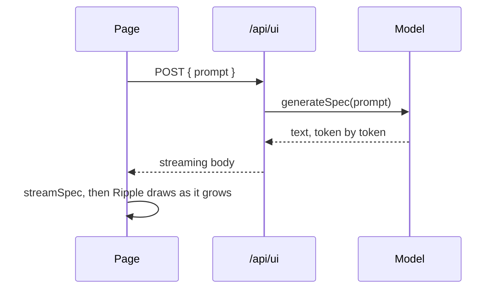

A model takes seconds to write a full spec. `streamSpec` parses the JSON as it arrives, so `<Ripple>` shows the UI as it grows instead of an empty space until the last token.

There are two halves: an endpoint that streams the model's output as text, and a page that feeds that stream to `streamSpec`.



## The endpoint

The endpoint returns the model's text as a streaming response body. The model call depends on your provider, so `generateSpec` below stands in for it. It should return a `ReadableStream<string>` of the text the model writes, and that text should be the spec JSON and nothing else.

```ts
// src/routes/api/ui/+server.ts
import type { RequestHandler } from './$types';
import { generateSpec } from '$lib/server/model';

export const POST: RequestHandler = async ({ request }) => {
  const { prompt } = await request.json();
  const text: ReadableStream<string> = await generateSpec(prompt);

  return new Response(text.pipeThrough(new TextEncoderStream()), {
    headers: { 'content-type': 'application/json; charset=utf-8' }
  });
};
```

To teach the model the widget catalog, put a manifest in its system prompt. The slim one covers the core widgets and the actions: `https://github.com/qbtrix/ripple-iui/releases/latest/download/manifest.slim.json`.

## The page

```svelte
<script lang="ts">
  import { Ripple } from '@ripple-ui/svelte';
  import { streamSpec, type StreamSpecStore } from '@ripple-ui/svelte/streaming';

  let store = $state.raw<StreamSpecStore | null>(null);
  let controller: AbortController | undefined;

  async function generate(prompt: string) {
    controller?.abort();
    controller = new AbortController();

    const res = await fetch('/api/ui', {
      method: 'POST',
      body: JSON.stringify({ prompt }),
      signal: controller.signal
    });
    if (!res.ok || !res.body) throw new Error(`Request failed: ${res.status}`);

    store = streamSpec(res.body, { signal: controller.signal });
  }
</script>

<button onclick={() => generate('A signup form with name and email')}>Generate</button>

{#if store}
  <Ripple streaming={store} onEvent={(e) => console.log(e.type)} />
{/if}
```

The button asks for "a signup form with name and email". A finished reply might look like this one, and it works as soon as it lands. Try signing up with a field left empty:

```ripple
{
  "version": "1.0",
  "state": { "name": "", "email": "", "joined": false, "missing": false },
  "ui": {
    "type": "card",
    "children": [
      { "type": "heading", "slot": "header", "props": { "text": "Join the beta", "level": 3 } },
      {
        "type": "flex",
        "show": "!state.joined",
        "props": { "direction": "column", "gap": "10px" },
        "children": [
          { "type": "input", "bind": "name", "props": { "label": "Name", "placeholder": "Ada Lovelace" } },
          { "type": "input", "bind": "email", "props": { "label": "Email", "placeholder": "ada@example.com" } },
          {
            "type": "button",
            "props": { "label": "Sign up" },
            "on_click": {
              "action": "flow",
              "steps": [
                { "action": "validate", "condition": "state.name", "message": "Add your name first." },
                { "action": "validate", "condition": "state.email", "message": "Add your email first." },
                { "action": "set", "target": "joined", "value": true }
              ],
              "on_error": [{ "action": "set", "target": "missing", "value": true }]
            }
          },
          { "type": "text", "show": "state.missing", "props": { "text": "Add your name and email first." } }
        ]
      },
      { "type": "text", "show": "state.joined", "props": { "text": "Thanks, {state.name}. We'll write to {state.email}." } }
    ]
  }
}
```

Hold the store in `$state.raw`. The store is already reactive, and a deep `$state` would wrap it in a proxy for nothing.

When `streaming` is set, Ripple renders `store.current` and ignores `spec`. Until the first chunk parses, it shows the `skeleton` placeholder (`card` by default; pass `skeleton="none"` to draw your own).

## React and plain HTML

`@ripple-ui/react` and `@ripple-ui/embed` have no `streamSpec`. You hand them the text so far, as raw partial JSON (or a partial object), and say when the stream ends. Nodes that are still incomplete show a quiet placeholder. The endpoint above works unchanged; any server that streams the model's text back does.

In React, pass the text as `spec` with `streaming`, and set `streaming={false}` when the model is done:

```tsx
import { useState } from 'react';
import { Ripple } from '@ripple-ui/react';

export function Generated() {
  const [text, setText] = useState('');
  const [done, setDone] = useState(false);

  async function generate(prompt: string) {
    const res = await fetch('/api/ui', { method: 'POST', body: JSON.stringify({ prompt }) });
    for await (const part of res.body!.pipeThrough(new TextDecoderStream())) setText((t) => t + part);
    setDone(true);
  }

  return text ? <Ripple spec={text} streaming={!done} /> : <button onClick={() => generate('A signup form')}>Generate</button>;
}
```

With the embed, mount with `{ streaming: true }`, call `card.update()` as text arrives and `card.finish()` at the end:

```js
import { mount } from '@ripple-ui/embed';

async function generate(prompt) {
  const res = await fetch('/api/ui', { method: 'POST', body: JSON.stringify({ prompt }) });
  const card = mount(document.querySelector('#card'), '', { streaming: true });
  let text = '';
  for await (const part of res.body.pipeThrough(new TextDecoderStream())) card.update((text += part));
  card.finish();
}
```

The rest of this page (the store, errors, limits) is about `streamSpec` in Svelte.

## The store

`streamSpec(source, options)` takes a `ReadableStream` or an async iterable of strings or bytes. It returns a store with three reactive fields and one method:

| Member | What it is |
|---|---|
| `current` | The most complete spec parsed so far, or `null` before the first parse. |
| `done` | `true` once the stream has ended, been cancelled, or failed. |
| `error` | A `StreamParseError` if something went wrong, otherwise `null`. |
| `cancel()` | Stops reading the stream. Calling it twice is safe. |

Every option is optional:

| Option | Default | What it does |
|---|---|---|
| `throttleMs` | `50` | Minimum time between parses. Text that arrives inside the window is parsed when it closes. |
| `maxBufferBytes` | `2000000` | Cancels the stream with an `overflow` error past this size. |
| `signal` | none | An `AbortSignal`. Aborting it does the same as `cancel()`. |
| `warnAtBytes` | `100000` | Dev builds only: one `console.warn` when the buffer first passes this size, a hint to move large data into `sources` or `api`. `0` or `Infinity` turns it off. |
| `onUpdate` | none | Called with each new spec, for logging or work outside a component. |

## Errors

`streamSpec` never throws. Problems land in `store.error`, and `error.kind` says which:

- `malformed`: the source threw. `error.lastValid` holds the last good spec.
- `incomplete`: the stream ended before anything parsed.
- `overflow`: the buffer passed `maxBufferBytes`.

The `StreamParseErrorKind` type also lists `aborted`, but `streamSpec` does not set it: `cancel()` or an aborted `signal` ends the stream with `done` true and `error` still `null`.

If the stream fails after part of the UI has rendered, Ripple keeps showing that part.

## Limits

- Streaming suits first renders. If a later chunk changes an input while someone is typing in it, the keystrokes are lost on the re-render.
- Node `Readable` streams aren't accepted directly. Wrap one with `Readable.toWeb()` first.
